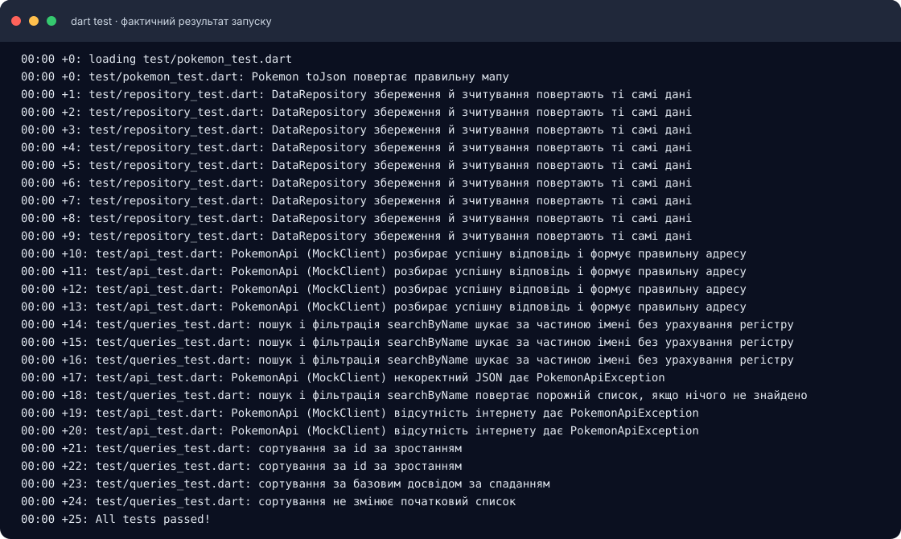
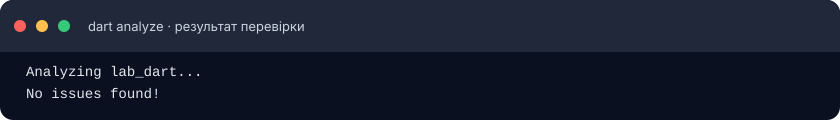
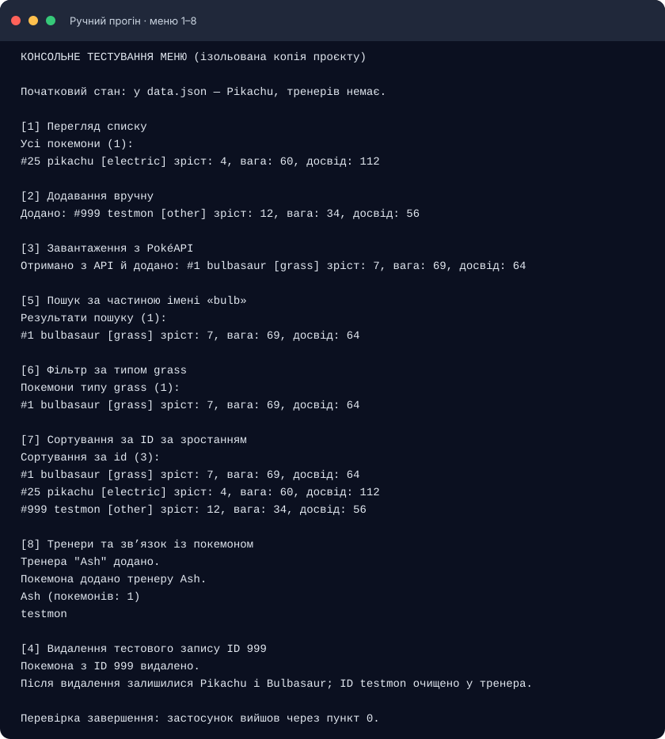
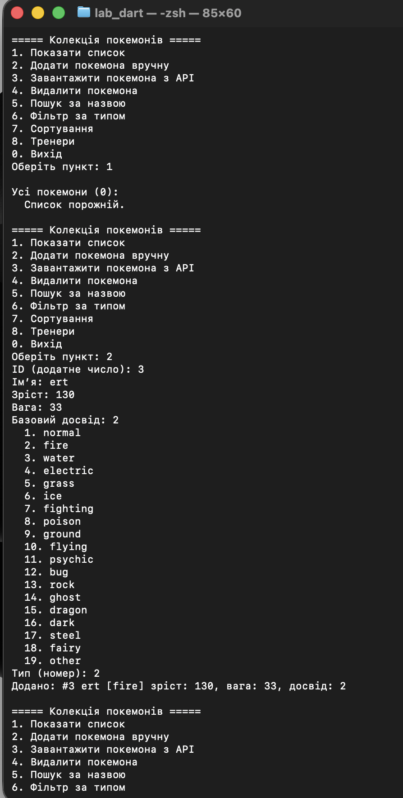
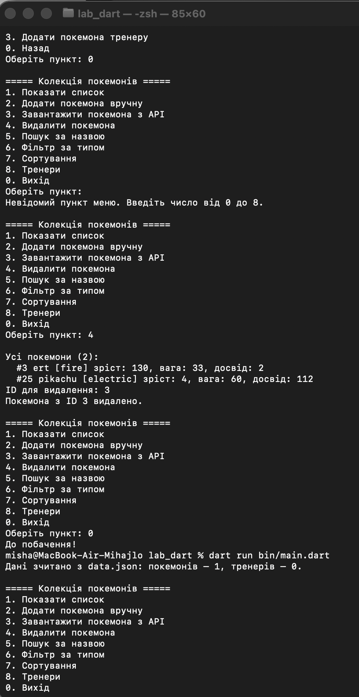
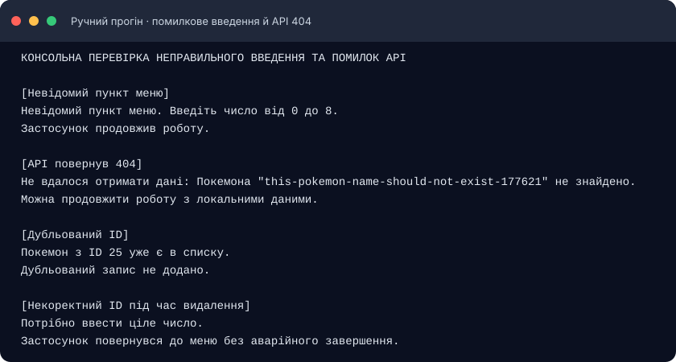
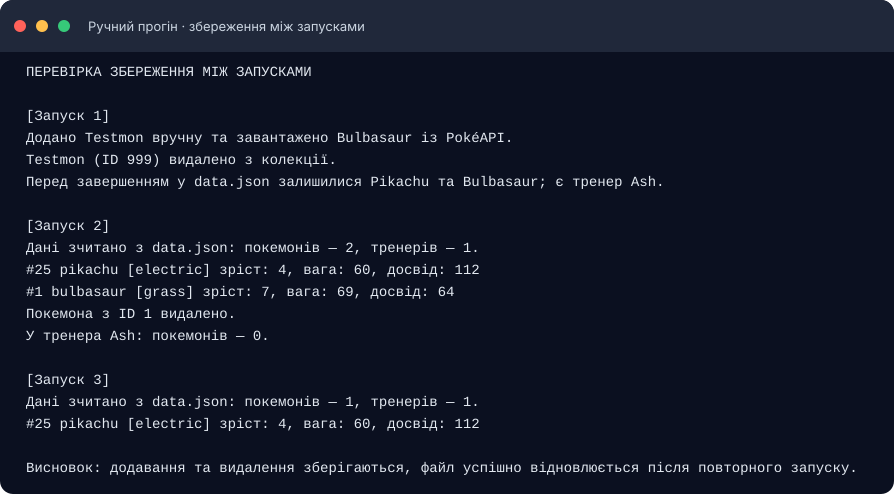

# Лабораторна робота 1–2. Створення консольного застосунку на Dart

## Інформація про студента

**Виконав:** Чернік Михайло Богданович  
**Група:** ІПЗ-31  
**Курс:** 4  
**Варіант:** 6 — колекція покемонів

---

## Зміст

1. [Мета роботи](#мета-роботи)
2. [Завдання та варіант](#завдання-та-варіант)
3. [Опис програми](#опис-програми)
4. [Моделі](#моделі)
5. [Робота з PokéAPI](#робота-з-pokéapi)
6. [Збереження даних](#збереження-даних)
7. [Структура проєкту](#структура-проєкту)
8. [Запуск](#запуск)
9. [Перевірка програми](#перевірка-програми)
10. [Висновок](#висновок)

## Мета роботи

Навчитися створювати консольний застосунок мовою Dart: описувати предметну область класами, отримувати дані з відкритого REST API, зберігати їх у JSON-файл і відновлювати під час наступного запуску програми.

## Завдання та варіант

За варіантом 6 я розробив програму для ведення колекції покемонів. Вона має текстове меню, локальне збереження у `data.json` і завантаження даних із PokéAPI.

У роботі також використані дві пов’язані моделі — покемон і тренер, перелік `enum` для типу покемона, абстрактний клас для серіалізації, окремі класи для API та файла, пошук, фільтр, сортування й автоматичні тести.

## Опис програми

Після запуску програма показує меню колекції:

| Пункт | Дія |
|---:|---|
| `1` | Показати всі покемони |
| `2` | Додати покемона вручну |
| `3` | Завантажити покемона з API за ім’ям або ID |
| `4` | Видалити покемона за ID |
| `5` | Знайти покемонів за ім’ям або частиною імені |
| `6` | Відфільтрувати список за типом |
| `7` | Відсортувати список за ID, ім’ям, зростом, вагою або досвідом |
| `8` | Відкрити меню тренерів |
| `0` | Вийти з програми |

У меню тренерів можна створити тренера, переглянути його список і додати йому покемона з колекції. Якщо покемона видалити, його ID також забирається зі списків тренерів.

Пошук не залежить від великих і малих літер. Сортування повертає новий список і не змінює початкову колекцію. Програма перевіряє введені значення та не завершується аварійно, якщо користувач помилився.

## Моделі

Основна модель — `Pokemon`. Вона містить ID, ім’я, зріст, вагу, базовий досвід і тип. Для перетворення у JSON використовується `toJson()`, а для відновлення з локального файла — фабричний конструктор `fromJson()`:

```dart
class Pokemon implements Storable {
  const Pokemon({
    required this.id,
    required this.name,
    required this.height,
    required this.weight,
    required this.baseExperience,
    required this.type,
  });

  final int id;
  final String name;
  final int height;
  final int weight;
  final int baseExperience;
  final PokemonType type;

  @override
  Map<String, dynamic> toJson() => {
        'id': id,
        'name': name,
        'height': height,
        'weight': weight,
        'baseExperience': baseExperience,
        'type': type.name,
      };
}
```

В API назви деяких полів відрізняються від локального JSON, тому для відповіді сервера є окремий `Pokemon.fromApi()`. Якщо тип із відповіді невідомий програмі, використовується `PokemonType.other`.

Друга модель — `Trainer`. Вона зберігає ім’я тренера та ID його покемонів. Метод `catchPokemon()` не дозволяє призначити того самого покемона двічі. Обидві моделі реалізують `Storable`, а `AppData` об’єднує списки покемонів і тренерів та операції над ними.

Тип покемона задано переліком `PokemonType`: `normal`, `fire`, `water`, `electric`, `grass`, `ice`, `fighting`, `poison`, `ground`, `flying`, `psychic`, `bug`, `rock`, `ghost`, `dragon`, `dark`, `steel`, `fairy` та `other`.

## Робота з PokéAPI

Для отримання покемона використовується запит:

```text
GET https://pokeapi.co/api/v2/pokemon/{name-or-id}
```

Наприклад, щоб отримати Пікачу:

```text
https://pokeapi.co/api/v2/pokemon/pikachu
```

З відповіді програма читає `id`, `name`, `height`, `weight`, `base_experience` і тип покемона. Приклад основних полів відповіді:

```json
{
  "id": 25,
  "name": "pikachu",
  "height": 4,
  "weight": 60,
  "base_experience": 112,
  "types": [
    { "slot": 1, "type": { "name": "electric" } }
  ]
}
```

Запит виконує `PokemonApi` з пакета `http`. Клієнт передається в конструктор, тому в тестах його можна замінити на `MockClient` і перевірити відповіді без звернення до сервера. Перевіряється `statusCode`; помилки 404, інші відповіді сервера, відсутність з’єднання, тайм-аут і некоректний JSON перетворюються на зрозуміле повідомлення. Основна частина запиту в `lib/services/pokemon_api.dart` виглядає так:

```dart
final response = await _client.get(uri).timeout(timeout);
if (response.statusCode != 200) {
  throw PokemonApiException(
    'Сервер відповів статусом ${response.statusCode}.',
    statusCode: response.statusCode,
  );
}
final decoded = jsonDecode(response.body);
if (decoded is! Map<String, dynamic>) {
  throw const FormatException('Очікувався JSON-обʼєкт.');
}
return Pokemon.fromApi(decoded);
```

## Збереження даних

За файл відповідає `DataRepository`. Під час запуску програма перевіряє, чи є `data.json`, читає його та відновлює покемонів і тренерів. Після додавання або видалення покемона, створення тренера чи призначення йому покемона файл оновлюється.

Приклад структури файла:

```json
{
  "pokemon": [
    {
      "id": 25,
      "name": "pikachu",
      "height": 4,
      "weight": 60,
      "baseExperience": 112,
      "type": "electric"
    }
  ],
  "trainers": [
    { "name": "Ash", "pokemonIds": [25] }
  ]
}
```

Якщо файла ще немає, програма починає з порожньої колекції. Якщо в JSON помилка або файл не вдається прочитати, виникає `StorageException`. Файл `data.json` доданий у `.gitignore`, тому локальні дані не зберігаються в GitHub-репозиторії.

## Структура проєкту

```text
lab_dart/
├── bin/
│   └── main.dart                  точка входу та консольне меню
├── lib/
│   ├── lab_dart.dart              експорти проєкту
│   ├── models/
│   │   ├── pokemon.dart           модель покемона, JSON та API-відповідь
│   │   ├── pokemon_type.dart      типи покемонів
│   │   ├── trainer.dart           модель тренера
│   │   ├── app_data.dart          спільні дані й операції з колекцією
│   │   └── storable.dart          спільний метод toJson()
│   ├── repositories/
│   │   └── data_repository.dart   читання і запис data.json
│   └── services/
│       ├── pokemon_api.dart       запити до PokéAPI
│       └── pokemon_queries.dart   пошук, фільтр і сортування
├── test/
│   ├── pokemon_test.dart          моделі та колекція
│   ├── repository_test.dart       збереження й читання JSON
│   ├── queries_test.dart          пошук, фільтрація та сортування
│   └── api_test.dart              відповіді API з MockClient
├── docs/screenshots/              журнали та знімки результатів
├── analysis_options.yaml          правила аналізатора
├── pubspec.yaml                   залежності проєкту
└── README.md
```

## Запуск

Після встановлення Dart SDK перейдіть у папку проєкту й виконайте:

```bash
dart pub get
dart run bin/main.dart
```

Для завантаження покемонів із PokéAPI потрібне підключення до інтернету. Інші операції працюють із локальними даними.

## Перевірка програми

### Автоматичні перевірки

Команди, які я запускав:

```bash
dart format .
dart test
dart analyze
```

Результати:

| Команда | Результат |
|---|---|
| `dart format .` | 14 файлів перевірено, змін не потрібно |
| `dart test` | Усі **25 тестів пройшли** |
| `dart analyze` | `No issues found!` |

Тести розподілені за файлами:

| Файл | Тестів | Що перевіряє |
|---|---:|---|
| `pokemon_test.dart` | 9 | JSON туди й назад, створення з API, додавання й видалення |
| `repository_test.dart` | 4 | збереження та читання файла, відсутній або некоректний JSON |
| `queries_test.dart` | 6 | пошук за частиною імені, фільтр за типом, сортування в обидва боки |
| `api_test.dart` | 6 | успішна відповідь, URL запиту, 404 і 500, некоректний JSON, помилка з’єднання |
| **Разом** | **25** | **усі тести пройшли** |

**Форматування:** результат `dart format .`.


**Модульне тестування:** `dart test` завершився повідомленням `All tests passed!`.



**Статичний аналіз:** `dart analyze` завершився без зауважень.



### Ручна перевірка меню

Я пройшов основні сценарії програми в окремій копії проєкту:

| Що перевіряв | Що отримав |
|---|---|
| Перегляд порожнього списку й додавання вручну | Новий запис з’явився в колекції |
| Завантаження Bulbasaur за ім’ям | API повернув `#1 bulbasaur [grass]` |
| Пошук `bulb` і фільтр `grass` | Знайшовся Bulbasaur |
| Сортування за ID | Список відсортувався за зростанням |
| Додавання тренера Ash і призначення покемона | Покемон з’явився в списку тренера |
| Повторний запуск | Покемони й тренер завантажилися з `data.json` |
| Невідомий пункт, повторний ID і неправильне ім’я для API | Програма показала повідомлення й продовжила роботу |
| Видалення покемона | Запис видалився з колекції та зі списку тренера |

Фрагмент ручного прогону пунктів меню 1–8: завантаження Bulbasaur з API, пошук, фільтр, сортування, робота з тренером і видалення тестового запису.



Скріншоти моїх запусків у Terminal:

**1. Порожня колекція та додавання покемона вручну.**



**2. Перевірка помилкового пункту, видалення та збереження даних після перезапуску.**



**Перевірка некоректного введення, дубльованого ID та відповіді API 404.**



**Перевірка збереження після виходу й повторного запуску.**



Журнали повних консольних запусків і команд перевірки збережені у `docs/screenshots/`.

## Висновок

У цій лабораторній я зробив консольну програму для колекції покемонів і тренерів. Під час роботи попрактикувався описувати дані класами, працювати з переліками та JSON, надсилати асинхронні запити до API й обробляти помилки. Також перевірив основні сценарії вручну та написав тести для моделей, файла, пошуку й API.

## Посилання

- Репозиторій: [github.com/mishachernika/lab_dart](https://github.com/mishachernika/lab_dart)
- API: [PokéAPI](https://pokeapi.co/)
