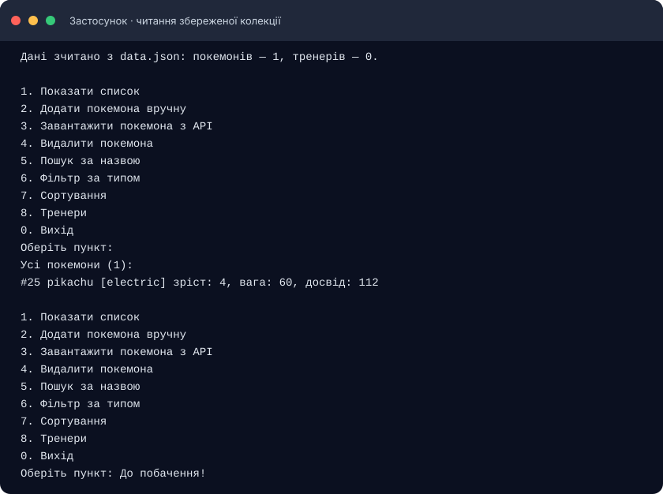

<div align="center">

# Лабораторна робота 1–2

## Консольний застосунок на Dart: колекція покемонів

**Варіант 6 · PokéAPI · збереження у JSON · модульні тести**

</div>

## Відомості про роботу

| Поле | Значення |
|---|---|
| Виконав | **Чернік Михайло Богданович** |
| Курс | **4 курс** |
| Спеціальність | **Інженерія програмного забезпечення (ІПЗ)** |
| Варіант | **№ 6 — колекція покемонів** |
| Мова програмування | Dart |
| API | [PokéAPI](https://pokeapi.co/) |

## Зміст

- [Мета роботи](#мета-роботи)
- [Постановка завдання](#постановка-завдання)
- [Можливості застосунку](#можливості-застосунку)
- [Предметна область і моделі](#предметна-область-і-моделі)
- [Взаємодія з PokéAPI](#взаємодія-з-pokéapi)
- [Збереження локальних даних](#збереження-локальних-даних)
- [Структура проєкту](#структура-проєкту)
- [Встановлення та запуск](#встановлення-та-запуск)
- [Тестування і статичний аналіз](#тестування-і-статичний-аналіз)
- [Скріншоти результатів](#скріншоти-результатів)
- [Висновок](#висновок)

## Мета роботи

Навчитися створювати консольний застосунок мовою Dart: описувати предметну область класами, отримувати дані з відкритого REST API, зберігати їх у локальний файл формату JSON та відновлювати під час наступного запуску. Додатково закріпити роботу з колекціями, асинхронними функціями, обробкою помилок і модульними тестами.

## Постановка завдання

За варіантом 6 розроблено консольну програму для ведення колекції покемонів. Застосунок поєднує локальні записи з даними зовнішнього сервісу PokéAPI та надає текстове меню для повсякденної роботи з колекцією.

У роботі реалізовано вимоги до моделей і JSON-серіалізації, зчитування та запису `data.json`, безпечного введення, отримання даних через HTTP, перевірки помилок API, окремих сервісу й репозиторію, пошуку, фільтрації, сортування та модульного тестування.

## Можливості застосунку

Після запуску користувач працює з головним меню:

| Пункт | Дія |
|---:|---|
| `1` | Показати всі покемони з локальної колекції |
| `2` | Додати покемона вручну: ID, ім’я, зріст, вагу, досвід і тип |
| `3` | Завантажити покемона з PokéAPI за ім’ям або ID |
| `4` | Видалити покемона за ID |
| `5` | Знайти покемонів за частиною імені |
| `6` | Відфільтрувати колекцію за типом |
| `7` | Відсортувати за ID, ім’ям, зростом, вагою або базовим досвідом |
| `8` | Відкрити меню тренерів |
| `0` | Завершити роботу |

У меню тренерів можна переглянути тренерів і їхніх покемонів, створити тренера та призначити йому покемона з колекції. Програма перевіряє введені числа, не допускає повторного додавання того самого ID покемона та повідомляє про відсутні записи.

Пошук за іменем нечутливий до регістру. Функції пошуку, фільтрації та сортування працюють із колекцією в пам’яті; сортування створює окремий результат і не змінює вихідний список.

## Предметна область і моделі

### `Pokemon`

Основна модель колекції. Містить такі поля:

| Поле | Тип | Опис |
|---|---|---|
| `id` | `int` | Унікальний ID покемона з PokéAPI |
| `name` | `String` | Ім’я покемона |
| `height` | `int` | Зріст у форматі, який повертає PokéAPI |
| `weight` | `int` | Вага у форматі, який повертає PokéAPI |
| `baseExperience` | `int` | Базове значення досвіду |
| `type` | `PokemonType` | Тип покемона з довідкового переліку |

Клас містить фабричний конструктор `fromJson()` для читання локального файла та `fromApi()` для перетворення відповіді API. Метод `toJson()` готує модель до збереження. Оператори рівності дають змогу порівнювати відновлений об’єкт з початковим у тестах.

### `PokemonType`

Тип покемона подано через `enum`: `normal`, `fire`, `water`, `electric`, `grass`, `ice`, `fighting`, `poison`, `ground`, `flying`, `psychic`, `bug`, `rock`, `ghost`, `dragon`, `dark`, `steel`, `fairy` та `other`. Значення `other` використовується, якщо API повернуло невідомий тип.

### `Trainer`

Пов’язана модель тренера містить ім’я та список ID покемонів, яких він зібрав. Метод `catchPokemon()` не додає один і той самий ID двічі. Коли покемона видаляють із колекції, його ID також очищується зі списків тренерів.

### `AppData` і `Storable`

`AppData` об’єднує списки покемонів і тренерів, а також надає операції пошуку, додавання та видалення. Абстрактний клас `Storable` визначає спільний метод `toJson()`, який реалізують об’єкти, що серіалізуються.

## Взаємодія з PokéAPI

Для отримання інформації використовується відкритий REST API [PokéAPI](https://pokeapi.co/), який не потребує ключа авторизації.

**Адреса запиту:**

```text
GET https://pokeapi.co/api/v2/pokemon/{name-or-id}
```

Наприклад, запит для Пікачу:

```text
https://pokeapi.co/api/v2/pokemon/pikachu
```

У відповідь API повертає JSON-об’єкт. З нього застосунок бере `id`, `name`, `height`, `weight`, `base_experience` і перший запис масиву `types`.

**Скорочений приклад відповіді:**

```json
{
  "id": 25,
  "name": "pikachu",
  "height": 4,
  "weight": 60,
  "base_experience": 112,
  "types": [
    {
      "slot": 1,
      "type": {
        "name": "electric",
        "url": "https://pokeapi.co/api/v2/type/13/"
      }
    }
  ]
}
```

Запит виконує `PokemonApi` із пакетом `http`. Клієнт передається в конструктор, тому в тесті його можна замінити на `MockClient` і перевірити розбір відповіді без інтернету. Сервіс перевіряє HTTP-статус, розбирає JSON та перетворює помилки з’єднання, тайм-аут, відповідь 404/5xx і некоректний JSON на зрозумілу помилку застосунку.

## Збереження локальних даних

Клас `DataRepository` відповідає за файл `data.json`:

1. Під час запуску програма перевіряє, чи існує файл.
2. Якщо файл є, `jsonDecode()` розбирає його, а фабричні конструктори відновлюють моделі.
3. Після зміни колекції `toJson()` перетворює дані на мапу, а `JsonEncoder.withIndent()` форматує JSON для читання.
4. Файл записується після додавання або видалення покемона, створення тренера чи призначення покемона тренеру.
5. Якщо файла ще немає, застосунок починає з порожньої колекції. Пошкоджений JSON або помилка файлової системи обробляються через `StorageException`.

Скорочена структура `data.json`:

```json
{
  "pokemon": [
    {
      "id": 25,
      "name": "pikachu",
      "height": 4,
      "weight": 60,
      "baseExperience": 112,
      "type": "electric"
    }
  ],
  "trainers": [
    {
      "name": "Ash",
      "pokemonIds": [25]
    }
  ]
}
```

`data.json` створюється локально під час роботи програми та доданий до `.gitignore`, тому особисті тестові записи не публікуються в репозиторії.

## Структура проєкту

```text
lab_dart/
├── bin/
│   └── main.dart                      точка входу, меню і взаємодія з користувачем
├── docs/
│   └── screenshots/                   ілюстрації виводу програми та перевірок
├── lib/
│   ├── lab_dart.dart                  публічні експорти пакета
│   ├── models/
│   │   ├── app_data.dart              спільний стан і операції з колекцією
│   │   ├── pokemon.dart               модель покемона та розбір JSON/API
│   │   ├── pokemon_type.dart          перелік типів покемонів
│   │   ├── storable.dart              спільний контракт серіалізації
│   │   └── trainer.dart               модель тренера
│   ├── repositories/
│   │   └── data_repository.dart       читання і запис data.json
│   └── services/
│       ├── pokemon_api.dart           HTTP-клієнт PokéAPI
│       └── pokemon_queries.dart       пошук, фільтр і сортування
├── test/
│   ├── api_test.dart                  тести HTTP-сервісу з MockClient
│   ├── pokemon_test.dart              тести моделей і колекції
│   ├── queries_test.dart              тести пошуку та сортування
│   └── repository_test.dart           тести JSON-репозиторію
├── analysis_options.yaml              правила статичного аналізатора
├── pubspec.yaml                       залежності та налаштування пакета
├── pubspec.lock                       зафіксовані версії залежностей
└── README.md                          опис і звіт про лабораторну
```

### Розподіл відповідальності

- `bin/main.dart` читає введення, показує меню та викликає методи сервісів і моделей.
- `lib/models/` містить структуру даних предметної області та їхню серіалізацію.
- `lib/services/pokemon_api.dart` ізолює запити до зовнішнього API.
- `lib/services/pokemon_queries.dart` містить логіку пошуку, фільтрації та сортування.
- `lib/repositories/data_repository.dart` ізолює читання і запис локального файла.
- `test/` перевіряє логіку окремо від живого API.

## Встановлення та запуск

Потрібен встановлений [Dart SDK](https://dart.dev/get-dart). Перейди в кореневу теку проєкту та виконай:

```bash
dart pub get
dart run bin/main.dart
```

Щоб перевірити основний сценарій:

1. Обери пункт `3` і введи `pikachu` або ID `25`.
2. Обери пункт `1`, щоб переглянути колекцію.
3. Вийди через пункт `0`.
4. Запусти застосунок знову: Пікачу має залишитися в списку, бо дані відновлюються з `data.json`.

Пошук, видалення та сортування працюють із локальною колекцією і доступні без підключення до API. Для завантаження нового покемона потрібен доступ до інтернету.

## Тестування і статичний аналіз

Для перевірки проєкту використовуються команди:

```bash
dart format .
dart test
dart analyze
```

Остання перевірка дала такі результати:

| Команда | Результат |
|---|---|
| `dart format .` | Форматовано; Dart SDK повідомив про форматування 4 файлів |
| `dart test` | **25 тестів пройшли** — `All tests passed!` |
| `dart analyze` | **Зауважень немає** — `No issues found!` |

### Покриття тестами

| Файл | Кількість | Що перевіряє |
|---|---:|---|
| `pokemon_test.dart` | 9 | JSON-серіалізацію, відновлення об’єктів, розбір API та операції колекції |
| `repository_test.dart` | 4 | Збереження/зчитування, відсутній файл і некоректні дані |
| `queries_test.dart` | 6 | Пошук, фільтрацію, сортування за зростанням і спаданням |
| `api_test.dart` | 6 | Успішну відповідь, URL, статуси 404/500, некоректний JSON та помилки з’єднання |
| **Разом** | **25** | |

API-тести використовують `MockClient` із `package:http/testing.dart`; вони не надсилають запитів до реального сервера. Репозиторій тестується у тимчасовій теці, яку тести видаляють після завершення.

## Скріншоти результатів

Нижче наведено зображення з фактичного виводу щойно виконаних команд і програми. Поруч у цій теці залишені текстові журнали запусків.

### Колекція після відновлення з файла



### Результат модульних тестів


### Результат статичного аналізу


## Висновок

У лабораторній роботі створено консольний застосунок мовою Dart для ведення колекції покемонів. Предметну область описано моделями `Pokemon` і `Trainer`; для типів використано `enum`, а для спільної серіалізації — абстрактний клас `Storable`. Дані можна отримувати з PokéAPI, зберігати у `data.json` і відновлювати під час наступного запуску.

Реалізовано меню, ручне додавання та видалення записів, пошук, фільтрацію, сортування, роботу з тренерами, обробку помилок API та файла. Окремі сервіс і репозиторій спрощують підтримку коду, а заглушка `MockClient` дає змогу тестувати HTTP-логіку без мережі. Усі 25 модульних тестів пройшли, статичний аналіз завершився без зауважень.

## Посилання

- **Репозиторій проєкту:** [github.com/mishachernika/lab_dart](https://github.com/mishachernika/lab_dart)
- **Документація API:** [pokeapi.co](https://pokeapi.co/)
